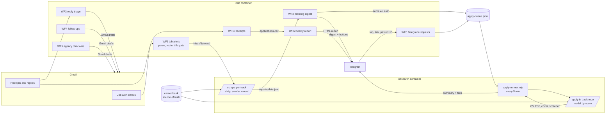

# Self-hosted AI job search pipeline

**A job-search assistant that runs on a home server.** It reads your job alert emails, scores every posting against
your recorded experience, and drafts a tailored CV, cover letter and screening answers overnight. Results arrive on
Telegram. You decide what gets sent, and you send it yourself.

Built with [Claude Code](https://www.anthropic.com/claude-code) (headless), [n8n](https://n8n.io) and the open-source
[ai-job-search](https://github.com/ai-job-search-dev/ai-job-search) skills (`/scrape`, `/apply`). It runs in two Docker
containers on a Synology NAS, or on any always-on Linux machine.

> **Nothing is submitted for you.** No workflow has a "send" step. Emails are Gmail drafts, applications are yours
> to submit. The pipeline never invents skills, certificates or results.

[中文（廣東話）簡介 → docs/README.zh-HK.md](docs/README.zh-HK.md)

---

## Contents

- [The problem](#the-problem)
- [What it does](#what-it-does)
- [Architecture](#architecture)
- [The n8n workflows](#the-n8n-workflows)
- [The apply queue and the runner](#the-apply-queue-and-the-runner)
- [Safety rules](#safety-rules)
- [Tech stack](#tech-stack)
- [Running costs](#running-costs)
- [Results so far](#results-so-far)
- [Lessons learned](#lessons-learned)
- [Setup](#setup)
- [Repository layout](#repository-layout)
- [Roadmap](#roadmap)
- [Licence](#licence)

## The problem

Applying well takes time. For each posting you read it, decide whether it fits, then rewrite your CV and cover letter
to match its words. That is an hour or more per job. If you search in more than one market at once (for example
permanent roles in one country, permanent roles in another, and day-rate contracts), it becomes a part-time job.

Most of that hour is reading, matching and first drafts, which a model does well, provided it is held to the truth.
The judgement (is this worth applying for, is this CV honest, do I press send) should stay with you.

## What it does

| Stage | How |
|---|---|
| **Find** | n8n reads job alert emails every 30 minutes and files each job under a search *track*. A daily `/scrape` also searches job boards that allow automated access. |
| **Filter** | A title gate drops roles that obviously don't fit (junior, sales, unrelated fields) before any model call. Optional pay floors drop jobs whose alert states pay below your floor. |
| **Score** | `/scrape` reads each posting and scores it 1–5 against your career record and the track's rules. |
| **Notify** | A Telegram digest each morning lists the top jobs per track, each with a ✍️ button that requests a CV. Jobs scored 4+ are queued automatically (capped per day). |
| **Draft** | A queue runner runs `/apply` one job at a time, overnight: tailored CV (LaTeX PDF), cover letter or short agency email, suggested screener answers, a "worth applying?" verdict, and questions about anything the record doesn't cover. |
| **Track** | Gmail receipts update `applications.csv`. Recruiter replies are classified, follow-ups and check-ins become Gmail drafts, and a weekly HTML report sums it all up. |

You can also send any job link, or paste a job description, to the Telegram bot.

## Architecture



**Two containers, one shared folder.**

| Container | Image | Role |
|---|---|---|
| `jobsearch` | Node 22 + Claude Code + LaTeX (built from `Dockerfile`) | Runs `/scrape` and `/apply` inside each track repo; runs the queue runner |
| `n8n` | `n8nio/n8n` | Email intake, Telegram bot, reports, follow-up drafts |

Both mount `shared/` (trackers, queue, outputs). n8n also mounts each track repo's `inbox/` and `reports/`. The n8n
editor listens on `127.0.0.1` only and is reached over an SSH tunnel.

**One private repo per track.** Each track is its own private clone of ai-job-search, with its own profile, master CV,
search queries and scoring weights. Shared rules live in `track-overlay/<track>/CLAUDE-track.md`, appended to each
repo's `CLAUDE.md` by `scripts/sync-to-repos.sh`. The example tracks here are `hk`, `uk` and `contract`; rename them
to suit your search.

**A career bank as the only source of facts.** Every role, project and achievement is a Markdown record with a stable
id and a "verified" flag. Master CVs are built from those records, and every CV line traces back to one. See
[docs/career-bank.md](docs/career-bank.md).

More detail: [docs/architecture.md](docs/architecture.md).

## The n8n workflows

All workflow JSON is generated from plain JavaScript files by `n8n-builder/build.py` and tested offline by
`n8n-builder/test.mjs` (550 assertions). Gmail nodes may only label, list or create drafts; a test fails the build if
any Gmail node could send.

| Workflow | When | What it does |
|---|---|---|
| **WF1 Job alerts** | Gmail trigger, every 30 min (plus a manual 14-day backfill) | Parses alert emails from more than 20 job boards and recruiters. Cleans tracking links and one-time login tokens, routes each job to a track by location and contract terms, applies the title gate and optional pay floors, dedupes against `seen-alerts.csv` and `applications.csv`, and appends to `repo-<track>/inbox/<date>.md`. An email it can't parse is handed to `/scrape` as raw text (marked untrusted) and reported, so a changed format never loses jobs silently. Handles Chinese job titles, where `\b` word boundaries don't work. |
| **WF2 Morning digest** | 07:45 Mon–Sat, after the scrape | Reads each track's `reports/<date>.json`, sends the top 5 jobs per track with a ✍️ button each, auto-queues up to 3 jobs scored 4+ that have no CV yet, and saves `digest/<date>.json` so button taps can be resolved later. |
| **WF3 Reply triage** | Gmail, every 5 min; digest at 20:00 | Only emails that look like recruiting mail are sent to the Claude API, with a strict JSON schema: interview invite, rejection, recruiter outreach, right-to-represent request, CV/rate update request, other. Updates the matching application row only when exactly one row matches. Warns in red when a right-to-represent request is for a client already submitted through another agency. Reply drafts come from fixed templates, not model text, so an email can't steer the reply. |
| **WF4 Follow-ups** | 09:00 daily | Agency applications with no update for 7 days get one polite follow-up **draft**. After 21 days with no reply, rows become "no response" (job-board applications are summarised in one message instead). |
| **WF5 Agency check-ins** | 09:15 daily | For each recruiter due by their cadence: an availability check-in **draft** with placeholders for availability, rate and recent work. Detects when you sent it and moves the next date on. Monthly list of agencies quiet for 90 days. |
| **WF6 Weekly report** | Saturday 21:00 | An HTML report (tables that turn into cards on a phone, light and dark) plus a short Telegram card: jobs scored per track, 4+ jobs, CVs made with their scores, CVs not yet applied for, applications from every source, title-gate drops, and job emails WF1 never read (handed to Monday's scrape). Scores come from 30 days of reports, so a CV made this week for a job scored last week keeps its score; hand-queued jobs use the score on their queue line. |
| **WF7** | — | Reserved for the online-CV update flow (see Roadmap). |
| **WF8 Telegram requests** | Every minute | Polls the Telegram Bot API. Button taps, links, `track link`, pasted JDs (in several parts), `urgent`/`急`, `applied <company>`/`已申請 <digest key>`. Writes queue lines and application rows. Accepts messages from your own chat id only. |
| **WF10 Application receipts** | Gmail, every 15 min (plus a 60-day backfill) | Reads "submitted / viewed / unsuccessful" emails from JobsDB/SEEK, Indeed and LinkedIn and adds or updates rows in `applications.csv`, so applications made outside the pipeline are counted too. Values from emails are neutralised so they can't run as spreadsheet formulas. |

(There is no WF9.) Per-workflow detail: [docs/workflows.md](docs/workflows.md). Phone commands:
[docs/telegram.md](docs/telegram.md). Builder and tests: [docs/n8n-builder.md](docs/n8n-builder.md).

## The apply queue and the runner

`shared/apply-queue.jsonl` is an append-only log. n8n, the Telegram bot and you (by hand, or from a chat session) add
lines; the runner reads the whole file and folds it into a list of requests.

| Line `type` | Effect |
|---|---|
| `job` | A CV request: `id`, `track`, `title`, `company`, `url`, optional `score`, `jd`, `needs_jd`, `notes` |
| `jd` | Appends a pasted part of the job description to request `id` |
| `urgent` | Runs request `id` now, outside the night window, skipping hold and budget |
| `approve` | Releases request `id` from a held track |
| `prio` | Sets an order within a track (`n`, lower runs first) |
| `last` | Pushes request `id` behind everything else |
| `cancel` | Drops request `id` (only before it has started) |

`notes` carries your instructions for one application ("lead with the regulatory experience", "say I'll start
learning the head office's language"). They go into the prompt but never override the truthfulness rules.

**`bin/apply-runner.mjs`**, started every 5 minutes by `scripts/apply-runner.sh`:

1. **Waits for the full JD.** A request is ready 3 minutes after its last pasted part.
2. **Orders the work.** Urgent first, then by track order (`TRACK_ORDER`), then `prio`, then queue order.
3. **Respects your limits.**
   - **Night window** (`apply-hours.txt`, e.g. `00:00-08:00`): only urgent requests run outside it.
   - **Holds** (`apply-hold.txt`): listed tracks wait for an `approve` line; Telegram tells you once.
   - **Budget** (`apply-budget.json`): caps runs between two dates and can force a model.
   - **Usage limit:** when the Claude plan's limit is hit, the job is re-queued and the runner pauses until the reset time it reads from Claude's output.
4. **Gets the JD without breaking site rules.** A pasted JD is used as-is. JobsDB links are read from the freehire.me public mirror, matched by job id. LinkedIn and Indeed jobs are looked up on the same index by title and company; the runner retries every 30 minutes for up to 12 hours, then asks you to paste. Other links are fetched by `/apply` itself, after a robots.txt check.
5. **Picks the model by score.** Score 4+ gets the strongest model (Opus), everything else the smaller one (Sonnet). Helper subagents always use the smaller model.
6. **Runs `/apply` headless** in the track repo with a 45-minute timeout and an allow-list (never `--dangerously-skip-permissions`). The Telegram token is removed from Claude's environment. The prompt adds CV quality rules: a plain-text contact line, a 4-line profile, 3 quantified key achievements, action + scope + result bullets, exactly 2 pages, and an ATS text-layer check.
7. **Delivers.** `/apply` writes `result.json` (company, role, PDF paths, cover text, verdict, up to 3 "not yet recorded" items, screener answers). The runner copies the files to `cv-out/<date_company_role>/`, logs to `apply-log.csv`, and sends a Telegram summary with the application link, the cover text and the screener answers.

Full protocol and states: [docs/apply-queue.md](docs/apply-queue.md).

## Safety rules

- **Nothing leaves without you.** No auto-submit. Outward emails are Gmail drafts. Reply drafts use fixed templates.
- **Honest CVs.** Only recorded experience, reordered and reworded. A skill's recorded level caps how it may be
  phrased ("familiar with" stays "familiar with"). Legitimate ATS optimisation only: no hidden text, keyword stuffing
  or prompt injection.
- **Outward documents list strengths only.** CVs, cover letters, agency emails and screener answers never say "gap",
  "not yet" or "no hands-on". The career bank is incomplete by nature: something it doesn't record is *unrecorded*, not
  missing.
- **Gaps become questions.** Unrecorded JD requirements come back to you as "not yet recorded: …" questions. Confirm
  one and it goes into the career bank, so the next CV can use it.
- **Pay floors stay private.** Floors filter alerts inside n8n and are never written into anything a recruiter sees.
- **Untrusted input stays data.** Job pages and emails are never treated as instructions. Claude runs with an
  allow-list; the bot token and chat id never reach the model; Telegram input is accepted from your chat only.
- **Respect for sites.** No scraping of sites without a job-seeker API, no CAPTCHA or bot-protection bypassing, no
  storing of login tokens found in alert links.
- **Privacy.** Track repos are new private repos, not public forks. Deploy keys are per repo, not account-wide.

More: [docs/safety.md](docs/safety.md).

## Tech stack

| Layer | Tools |
|---|---|
| Host | Synology DS-series NAS with Container Manager (any Docker host works) |
| Agent | Claude Code CLI in headless mode (`claude -p`), Opus and Sonnet models |
| Job-search skills | [ai-job-search](https://github.com/ai-job-search-dev/ai-job-search) `/scrape`, `/apply`, portal CLIs (bun) |
| Orchestration | n8n 2.x (self-hosted), workflows generated from JS by Python |
| Messaging | Telegram Bot API (digest, buttons, requests, file delivery) |
| Email | Gmail API via OAuth (alerts, receipts, replies, drafts only) |
| Classification | Anthropic Messages API with JSON-schema output (WF3 only) |
| Documents | LaTeX: moderncv via lualatex for CVs, xelatex for cover letters; Noto CJK fonts |
| Job index | freehire.me public API (mirrors of sites that block automated reads) |
| Tests | Node.js test harness that runs every Code node against fixtures |

## Running costs

- **Claude Code** runs on a Claude subscription, so there is no per-token bill for scraping and CV drafting. The
  levers are which model runs what and when:
  - daily `/scrape` on the smaller model;
  - `/apply` on the strongest model only for jobs scored 4+;
  - the night window, so daytime usage stays yours;
  - an optional run budget until the plan's weekly reset.
- **WF3 classification** uses the Anthropic API, billed per token and separate from the subscription. It sends only
  emails that look like recruiting mail, with low effort and short outputs. Switch it to a smaller model if volume
  grows.
- **n8n, Telegram and Gmail** cost nothing when self-hosted, apart from the server's electricity.

## Results so far

In its first full fortnight (4–19 November 2026), across three tracks:

| Metric | Value |
|---|---|
| Tailored CV packs drafted (CV, cover/agency email, screener answers, verdict, gap questions) | **69** (contract 37, region A permanent 21, region B permanent 11) |
| Workflows in production | 8 n8n workflows plus the queue runner and the daily scrape |
| Offline test assertions | 550 |
| Applications submitted automatically | 0, by design |

The pipeline made *drafting* nearly free. It did not make *applying well* free. See below.

## Lessons learned

1. **Volume isn't the goal.** When a CV costs nothing, you start applying wide. Responses depend on fit and positioning,
   not on how many applications go out. The title gate and the 4+ threshold exist to keep the list short. Tighten
   them before you loosen them.
2. **Check the text the ATS reads, not the page you see.** moderncv's contact icons put glyph names ("MOBILE-ALT",
   "Envelope") into the PDF text layer, beside the phone number and email. The CV looked perfect. Every `/apply` run now
   dumps the text layer and checks for this.
3. **Lead with numbers.** First drafts were accurate but generic ("established governance frameworks"). The prompt now
   asks for a short profile, three quantified key achievements, and action + scope + result bullets. It favours
   career-bank records that carry numbers.
4. **"Unrecorded" is not "missing".** Early drafts were honest to a fault ("no hands-on experience with X"). Splitting
   outward documents (strengths only) from `gaps.md` (questions for you) fixed the tone without bending the truth.
5. **Contract roles move in hours.** A night-only window is cheap but slow. The `urgent` command, and a midday scrape
   for the contract track, matter more than a better model.
6. **Keep the score with the CV.** The weekly report showed "–" for CVs made this week for jobs scored the week before.
   It now reads 30 days of reports, plus the score on hand-queued jobs.
7. **Treat n8n Code nodes as code.** Generating workflows from `.js` files and running each node against fixtures made
   changes safe. One rule earned its place twice: importing a workflow from the CLI unpublishes it, so publish again.
8. **Telegram Markdown breaks on underscores** in job titles and URLs. Send HTML and escape `& < >`.
9. **Sites that block bots are a boundary, not a puzzle.** Alert emails, public mirrors and "please paste the JD" cover
   everything without bypassing anything.

## Setup

Full steps: [docs/architecture.md](docs/architecture.md). In short:

1. **Check that Claude Code runs on your CPU.** Some NAS CPUs lack AVX. If needed, pin the last plain-JS release
   (`CLAUDE_CODE_VERSION` in `.env`) or run the `jobsearch` container on another machine.
2. **Create the track repos.** For each track, clone ai-job-search into `repo-<track>/` and push it to a **new
   private** repo (not a fork). Use a per-repo deploy key.
3. **Build and start.** Copy `examples/.env.example` to `.env` and `docker-compose.example.yml` to
   `docker-compose.yml`, then `DOCKER_BUILDKIT=0 docker build -t ai-job-search-jobsearch:latest .` and
   `docker compose up -d`.
4. **Set up each track.** Log in to Claude Code in the container, run `/setup` in each repo, add your career bank
   under `shared/career-bank/` (templates in `examples/career-bank-templates/`), write the track overlay (examples in
   `examples/track-overlay/`), then run `scripts/sync-to-repos.sh`. Start from
   `examples/claude-settings.example.json` for each repo's allow-list.
5. **Generate and import the workflows.** In `n8n-builder/`, run
   `TELEGRAM_CHAT_ID=… GMAIL_LABEL_ID=… CANDIDATE_NAME="…" python3 build.py`, then `node test.mjs`. Import
   `out/*.json`, attach the Gmail, Telegram and Anthropic credentials, set your pay floors in WF1's `PAY_FLOOR` (or
   leave them at 0), and publish each workflow.
6. **Schedule.** `scripts/scrape.sh` daily at 07:00, and `scripts/apply-runner.sh` every 5 minutes (DSM Task
   Scheduler or cron, as root). Copy `bin/apply-runner.mjs` to `shared/bin/`, and put
   `apply-hours.txt` (and optionally `apply-hold.txt`, `apply-budget.json`) in `shared/`.

## Repository layout

```
.
├── README.md                     this file
├── Dockerfile                    jobsearch image: Node 22, Claude Code, LaTeX, bun, poppler
├── docker-compose.example.yml    the two containers
├── bin/apply-runner.mjs          queue runner (copy to shared/bin/)
├── scripts/
│   ├── scrape.sh                 daily /scrape per track, pushes reports to the track repo
│   ├── apply-runner.sh           every 5 min: runs the queue runner inside the container
│   ├── apply-batch.sh            one-off: work through the queue, stop at the first failure
│   └── sync-to-repos.sh          copies career bank, masters, answers and track rules into each repo
├── n8n-builder/
│   ├── build.py                  generates out/WF*.json from js/
│   ├── js/                       Code-node sources (lib, title gate, one file per workflow step)
│   └── test.mjs                  runs every Code node against fixtures
├── examples/                     .env, queue, window/hold/budget files, allow-list, track overlay, career-bank templates
└── docs/                         architecture, workflows, queue, Telegram, career bank, safety, builder, 中文簡介
```

Not in this repository, on purpose: the career bank, CVs, applications, trackers, recruiter lists, n8n exports with
credential ids, and anything naming employers or clients.

## Roadmap

- **Online CV (WF7).** A static site generated from verified career-bank records, rebuilt through a pull request
  whenever a record is verified.
- **Visual CV variant.** A one-page version with a career timeline and skill-depth chart, for sending directly to a
  person. ATS uploads stay on the single-column text CV.
- **Response analytics.** Response rate by track, source, score and CV variant, so the title gate and thresholds can
  be tuned from data.
- **Interview prep pack.** Likely questions and STAR answers drawn from the records that `/apply` used.
- More alert-email parsers, and setup notes for Unraid, TrueNAS and Raspberry Pi with a remote Claude host.

## Licence

MIT for the code and documentation in this repository (see `LICENSE`). The
[ai-job-search](https://github.com/ai-job-search-dev/ai-job-search) skills are a separate MIT-licensed project. They
are referenced and cloned into your private track repos, not included here. n8n is under its own
[Sustainable Use License](https://docs.n8n.io/sustainable-use-license/).
